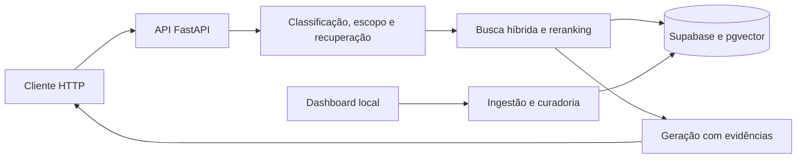

# Digi — API RAG para suporte técnico

Backend para responder perguntas técnicas a partir de uma base documental, combinando recuperação de trechos, geração de respostas e histórico de conversa. O projeto também inclui ingestão de documentos, registro de feedback, ferramentas de avaliação e um dashboard local de curadoria.

A proposta é reunir consulta à documentação e manutenção da base em um mesmo fluxo: receber a pergunta, recuperar evidências, produzir uma resposta e permitir revisar os resultados. Este repositório implementa a API e suas ferramentas; clientes de mensageria ficam fora dele.

## Funcionalidades

- Classificação de intenção, validação de escopo e recuperação executadas de forma concorrente.
- Busca híbrida com PostgreSQL/pgvector e full-text, reescrita condicional de perguntas e reranking.
- Histórico por usuário com identificador pseudonimizado por HMAC-SHA256.
- Ingestão de texto, PDF e coleções de API, com estratégias de chunking por documento.
- Registro da fonte original para permitir reprocessar o chunking.
- Feedback e dashboard Streamlit para métricas, curadoria e ingestão.
- Harness de avaliação com rubricas, juiz LLM e análise de instabilidade.

## Tecnologias e arquitetura

| Camada        | Tecnologias                               |
| ------------- | ----------------------------------------- |
| API           | Python 3.12, FastAPI, Uvicorn, Pydantic   |
| Dados e busca | Supabase, PostgreSQL, pgvector, full-text |
| Provedores    | OpenAI; Mistral OCR opcional              |
| Dashboard     | Streamlit                                 |
| Qualidade     | pytest, Ruff, mypy, Bandit, pip-audit     |



As rotas HTTP ficam em `src/api/`; a orquestração, em `src/pipeline/`; e as integrações externas, em `src/services/`. O dashboard é um processo separado e permanece vinculado a `127.0.0.1`.

## Instalação e execução local

Requisitos: Git e Python 3.12. Integrações de geração e persistência exigem contas e credenciais próprias.

```sh
git clone https://github.com/NicolasLimao/projeto_digi_python-publico.git
cd projeto_digi_python-publico
python3.12 -m venv .venv
source .venv/bin/activate
python -m pip install -r requirements-dev.lock
cp .env.example .env
python main.py
```

No PowerShell, crie o ambiente com `py -3.12 -m venv .venv` e ative com `.venv\Scripts\Activate.ps1`.

A API fica em **http://localhost:8000**; `/health` é público. No desenvolvimento, a documentação interativa fica em **http://localhost:8000/docs**. Sem credenciais de provedores é possível executar os testes offline e verificar a inicialização; consultas RAG e operações na base requerem configuração. `/ready` informa a prontidão das dependências.

### Configuração

Preencha somente o `.env` local. O exemplo completo de variáveis está em [.env.example](.env.example).

| Variável                                     | Finalidade                                                      |
| -------------------------------------------- | --------------------------------------------------------------- |
| `OPENAI_API_KEY`                             | Embeddings e geração                                            |
| `SUPABASE_URL` / `SUPABASE_SERVICE_ROLE_KEY` | Acesso do backend ao banco                                      |
| `API_AUTH_TOKEN`                             | Credencial enviada em `X-API-Key` nas rotas `/api/*`            |
| `USER_ID_SALT`                               | Segredo estável para pseudonimizar identificadores do histórico |
| `ENVIRONMENT`                                | Modo de execução; produção exige os segredos obrigatórios       |
| `MISTRAL_API_KEY`                            | OCR opcional                                                    |
| `DIGI_API_BASE`                              | API usada pelo dashboard; padrão `http://localhost:8000`        |

Antes de usar um banco novo, aplique as migrações de [db/migrations](db/migrations/) na ordem numérica e confira os requisitos descritos na [documentação técnica](DOCUMENTACAO.md). As tabelas sensíveis usam RLS; a chave administrativa pertence apenas ao backend.

O projeto inclui configuração de referência para Square Cloud. Uma instalação própria exige configurar domínio, variáveis e deploy; publicar este código não cria uma API hospedada.

### Rotas principais

| Rota                     | Uso                        |
| ------------------------ | -------------------------- |
| `GET /health`            | Saúde do processo          |
| `GET /ready`             | Prontidão das dependências |
| `POST /api/rag/query`    | Consulta ao pipeline RAG   |
| `POST /api/rag/feedback` | Registro de feedback       |
| `POST /api/ingest`       | Ingestão de conteúdo       |
| `/api/history/*`         | Operações de histórico     |

Os contratos de payload ficam na documentação interativa e nos modelos Pydantic. As rotas `/api/*` passam pela dependência de autenticação; configure o token também ao usar ferramentas locais.

### Dashboard

No mesmo ambiente virtual, instale as dependências adicionais e execute em outro terminal:

```sh
python -m pip install -r dashboard/requirements.txt
streamlit run dashboard/app.py --server.address 127.0.0.1 --server.port 8501
```

Abra **http://127.0.0.1:8501**. O dashboard lê o `.env` da raiz e precisa das credenciais correspondentes para acessar a base e executar ações. Ele não tem login próprio e deve permanecer local.

## Avaliação demonstrativa

[evals/dataset.jsonl](evals/dataset.jsonl) contém **32 casos sintéticos** ancorados em um manual fictício, [evals/corpus/demo.md](evals/corpus/demo.md). Eles demonstram o formato do harness; não contêm feedback real e não comprovam qualidade em produção.

```sh
python evals/run_eval.py --dry-run
```

Esse comando carrega e valida os casos sem consultar provedores. Uma avaliação real exige uma instância de teste com o corpus correspondente e credenciais próprias. O procedimento e o armazenamento de datasets privados estão em [evals/README_PUBLICO.md](evals/README_PUBLICO.md).

## Estrutura

```text
main.py                entrada da API
src/api/               endpoints, autenticação e dependências
src/pipeline/          orquestração do RAG
src/agents/            classificação, escopo, recuperação e formatação
src/services/          integrações, histórico, ingestão e chunking
src/models/            contratos Pydantic
dashboard/             métricas, curadoria e ingestão locais
evals/                 dataset demonstrativo e ferramentas de avaliação
db/migrations/         migrações ordenadas do banco
tests/                 suíte offline e testes de contratos internos
```

## Testes e qualidade

Com as dependências de desenvolvimento e do dashboard instaladas:

```sh
ruff check .
ruff format --check .
mypy src main.py evals dashboard
pytest -q
bandit -q -r src main.py -c pyproject.toml
pip-audit -r requirements.lock --progress-spinner off
```

Os testes comuns simulam os provedores. O CI executa lint, tipos, testes, análise estática de segurança e auditoria de dependências. Testes de transporte e fixtures não demonstram qualidade das respostas de um modelo real.

## Estado e limitações

A qualidade depende dos documentos, da recuperação, da geração e da calibração das rubricas. A edição pública não inclui uma base de produção nem métricas de contas reais. Reprocessamento de documentos e curadoria exigem revisão das etapas de publicação e backup descritas na documentação.

A integração Jev/TypeSafe é opcional e permanece desativada por padrão. Sua ativação depende de avaliação real e calibração; não é requisito para executar a API principal. Detalhes em [JEV_OPERACAO.md](docs/JEV_OPERACAO.md).

## Documentação

- [Documentação técnica](DOCUMENTACAO.md) e [segurança](SECURITY.md)
- [Guardrails](docs/GUARDRAILS.md), [SDD](docs/SDD.md) e [TDD](docs/TDD.md)
- [Contrato de recuperação e evidências](specs/010-rag-recuperacao-evidencia.md)
- [Avaliação demonstrativa](evals/README_PUBLICO.md)
- [Dados locais e política da edição pública](PUBLICATION.md)

Desenvolvido por [NicolasLimao](https://github.com/NicolasLimao).
