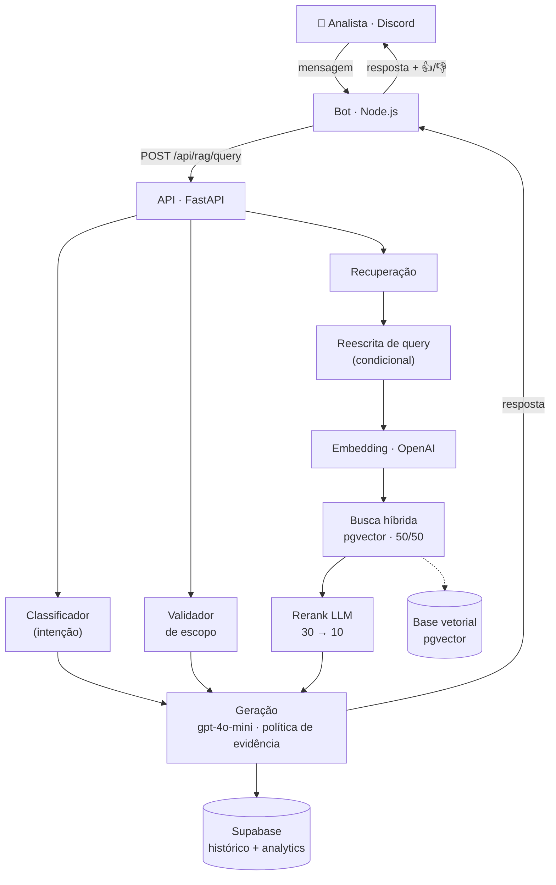

# Digi — Agente RAG para Suporte Técnico

> Edição pública com exemplos inteiramente fictícios. O dataset de avaliação foi substituído por 32 casos sintéticos ancorados em um manual inventado; ele não comprova desempenho ou qualidade em produção. Os padrões de API do dashboard e do runner são locais. Veja [avaliação demonstrativa](evals/README_PUBLICO.md) e [PUBLICATION.md](PUBLICATION.md).


> Assistente conversacional (RAG) que responde dúvidas técnicas via Discord, fundamentado na documentação oficial de uma plataforma de atendimento multicanal (Digisac). Transforma minutos procurando em manuais numa conversa de segundos — com respostas rastreáveis à fonte.

**Stack:** Python · FastAPI · Supabase (PostgreSQL + pgvector) · OpenAI · Node.js (bot) · Streamlit

---

## Por que este projeto

Não é "mais um chatbot com IA". É um sistema RAG **de ponta a ponta e em produção**, construído com a disciplina de um produto real: arquitetura desacoplada, **avaliação mensurável**, decisões guiadas por dado (inclusive descartando as próprias hipóteses quando a medição as reprovava), segurança levada a sério e deploy reproduzível.

**O que este projeto demonstra:**

- **RAG aplicado de verdade** — busca híbrida, reescrita de query, reranking, memória multi-turno.
- **Engenharia orientada a medição** — um *harness* de avaliação com juiz LLM, votação por maioria e detector de instabilidade; melhorias validadas por A/B antes de irem a produção.
- **Rigor de segurança** — pseudonimização de PII, RLS no banco, autenticação da API, segredos fora do repositório e auditoria de dependências.
- **Ciclo de produto** — loop de feedback que vira dataset rotulado, dashboard de curadoria, deploy contínuo.

---

## Arquitetura



As três tarefas iniciais (classificar, validar escopo, recuperar) rodam **concorrentemente** via `asyncio.gather` — a latência da classificação fica escondida atrás da busca. A geração só dispara quando o pool reranqueado está pronto.

---

## Pipeline RAG

- **Busca híbrida ponderada** — combinação 50/50 de semântica (embeddings) e full-text (palavra-chave) por função PL/pgSQL no Supabase: relevância por significado + precisão de termos técnicos.
- **Reescrita de query** — uma mensagem ruidosa (`Dúvida do cliente — Obs.1 — Obs.2…`) é destilada para a intenção real antes de virar vetor; em follow-ups, usa o histórico pra resolver referências (`e como faço isso?` → query autossuficiente).
- **Gate adaptativo** — perguntas curtas pulam a reescrita (economiza uma chamada de modelo); perguntas longas/com histórico passam pelo pipeline completo.
- **Reranking com pool limitado** — busca 30 candidatos por padrão (`RETRIEVAL_CANDIDATE_COUNT`, máximo 60), reordena com o LLM e mantém até 10 no contexto final. Curadorias preservam até 6000 caracteres na seleção; relevância depende da pergunta. [Contrato e validação](specs/010-rag-recuperacao-evidencia.md).
- **Memória multi-turno por usuário** — as últimas trocas do mesmo usuário (janela de 60 min) entram no prompt, com contexto **isolado por usuário** (chave pseudonimizada — ver Segurança).
- **Geração com evidência** — orientação, resposta-cliente e bug respeitam as condições da pergunta e a curadoria aplicável. Documentos e histórico são dados separados das instruções. As regras específicas de servidor estão em avaliação; a qualidade integral desse assunto ainda não foi aprovada.

Decisão em 06/10/2026: manter o RAG OpenAI como arquitetura principal e o Jev
desligado (`RERANK_PROVIDER=openai`, `TYPESAFE_RERANK_SHADOW=false`,
`TYPESAFE_VERIFY_MODE=off`). Os pilotos não demonstraram ganho suficiente para
adoção; ferramentas e resultados documentados permanecem para rastreabilidade.
Prioridade: feedback revisado, correções da base e regressões com perguntas reais.
A próxima revisão de servidor está registrada em
[PENDENCIAS_RAG.md](docs/PENDENCIAS_RAG.md).

---

## Base de conhecimento & re-chunking

A qualidade de um RAG tem como teto a qualidade dos *chunks*. A base foi **reconstruída de ponta a ponta** com estratégias específicas por tipo de documento:

- **Manual (prosa):** limpeza de ruído de OCR → *chunking* contextual respeitando seções, com **breadcrumb de heading em cada chunk** → uma frase de contexto gerada por LLM (situacional, sem inventar fato). Resultado: ~880 chunks, 100% ancorados na sua seção, sem os pedaços gigantes e cacos do chunker anterior.
- **API (Postman Collection):** *chunking* **determinístico** — 1 endpoint = 1 chunk (método + URL + parâmetros + corpo), zero geração por LLM (é onde alucinação mais custa). ~240 chunks precisos.
- **Fonte crua durável:** o texto original de cada documento fica salvo, permitindo re-chunkar quando a estratégia melhorar — sem re-OCR nem re-parse. A publicação insere o lote novo, confere a contagem, salva backup e remove o antigo em etapas. As limitações desse processo estão registradas na [revisão de código](docs/CODE_REVIEW_20260930.md).

---

## Harness de avaliação (o diferencial)

A pergunta "melhorou?" só tem valor com número. O projeto tem uma suíte de avaliação própria:

- **Dataset versionado** de casos reais (perguntas + fatos esperados + erros proibidos), derivados do feedback de produção.
- **Juiz LLM** que avalia cada resposta contra a rubrica do caso, com **votação por maioria** sobre N repetições (a geração é não-determinística; uma rodada só engana).
- **Detector de instabilidade** que separa falha real de ruído estatístico.
- **Relatórios datados** com delta entre rodadas, para acompanhar regressões/correções ao longo do tempo.

Isso transformou "achismo" em método: cada mudança candidata é medida antes de virar produção.

---

## Decisões guiadas por dado

O que mais diferencia este projeto é o **método honesto**: medir, e aceitar o que a medição diz — inclusive quando ela reprova a própria ideia.

- **Temperatura não move qualidade** — medido, descartado como lever.
- **Editar o prompt para os casos que falham não ajudou** — A/B offline (mesmos chunks, prompt atual vs. proposto, juiz da rubrica) deu zero melhora. Não foi a produção.
- **Baixar o *threshold* de recuperação piorou** — contra-intuitivo, mas a medição mostrou que diluía os melhores chunks.
- **Diagnóstico com evidência:** a recuperação já traz o trecho certo em rank 1–2; o teto de qualidade restante está na **completude da geração e na calibração das rubricas**, não no chunking. Saber *onde não* investir vale tanto quanto saber onde investir.

Essa disciplina — descartar levers por medição em vez de por ego — é rara, e é o que mantém o sistema honesto.

---

## Segurança

- **Pseudonimização de PII** — o ID de Discord do usuário nunca é persistido em claro; é substituído por um **HMAC-SHA256 com salt secreto** antes de gravar/consultar, preservando o agrupamento por usuário (a memória multi-turno continua funcionando) sem guardar o identificador real.
- **RLS (Row Level Security)** no Supabase — só a `service_role` acessa as tabelas sensíveis; chaves públicas por design não leem dados.
- **Segredos fora do repositório** — configuração pela `.env` local ou pelas variáveis do ambiente de hospedagem.
- **Autenticação da API** — `X-API-Key` em todo `/api/*` quando o token está configurado; obrigatório em produção.
- **CI de segurança** — `bandit` (SAST) e `pip-audit` (CVEs de dependência) no pipeline; lockfiles pinados e auditados.

---

## Deploy

- **Execução Python** — API com `python main.py`; dashboard com `streamlit run dashboard/app.py --server.address 127.0.0.1`. As dependências são instaladas no ambiente virtual.
- **SquareCloud** — hospedagem 24/7 com **auto-deploy via GitHub**: cada `push` em `main` redeploya. Variáveis sensíveis só no painel da hospedagem.

---

## Dashboard de curadoria

App em Streamlit de uso exclusivamente local, sem login: métricas de feedback, dúvidas pendentes, ingestão de documentos e re-chunking da base. A configuração do projeto fixa o servidor em `127.0.0.1`. O dashboard acessa o Supabase com a chave de backend configurada na `.env`.

---

## Stack

| Camada | Tecnologia |
|--------|-----------|
| API | Python 3.12, FastAPI, Uvicorn, Pydantic v2 |
| Bot | Node.js, discord.js v14 (repositório separado) |
| Banco | Supabase (PostgreSQL + pgvector), RLS |
| Embeddings | OpenAI `text-embedding-3-small` (1536 dim) |
| Geração / juiz | OpenAI `gpt-4o-mini` |
| Ingestão PDF | PyMuPDF + Mistral OCR (fallback p/ PDF imagem) |
| Dashboard | Streamlit |
| Infra | Ambiente virtual Python · SquareCloud (auto-deploy) |
| Qualidade | ruff, mypy, pytest, bandit, pip-audit (CI no GitHub Actions) |

---

## Estrutura

```
projeto_digi_python/
├── main.py                 entrypoint FastAPI (uvicorn)
├── src/
│   ├── app.py              factory, lifespan, middlewares
│   ├── api/                endpoints, auth, dependências
│   ├── pipeline/           orquestrador do fluxo RAG
│   ├── agents/             classifier · scope_validator · rag_agent · formatter
│   ├── services/           openai · supabase · history · ingestion · chunker · postman_chunker
│   ├── security.py         pseudonimização de PII
│   └── models/             contratos Pydantic
├── evals/                  dataset + runner (juiz LLM) + detector de instabilidade
├── dashboard/              app Streamlit (métricas, curadoria, ingestão)
├── db/migrations/          migrações ordenadas + endurecimento de RLS
├── scripts/                utilitários operacionais (ex.: pseudonimização retroativa)
├── requirements*.lock      ambientes reproduzíveis (pinados)
└── .github/workflows/      CI de qualidade e segurança
```

Bot Discord em repositório separado: [github.com/NicolasLimao/digi-bot](https://github.com/NicolasLimao/digi-bot)

---

## Início rápido

Requer Python 3.12. Sobe local sem credenciais para *health checks* e testes; em produção, falha cedo se faltarem segredos obrigatórios.

```bash
python -m venv .venv && source .venv/bin/activate
python -m pip install -r requirements-dev.lock
pytest -q          # suíte offline (sem rede)
python main.py     # API em http://localhost:8000  (/health público)
```

Para visualizar o dashboard, instale suas dependências no mesmo ambiente virtual e execute em outro terminal:

```bash
source .venv/bin/activate
python -m pip install -r dashboard/requirements.txt
streamlit run dashboard/app.py --server.address 127.0.0.1 --server.port 8501
```

Dashboard: http://localhost:8501. Ele lê a `.env` da raiz. `DIGI_API_BASE` define a API usada nas ações de ingestão; para a API local, configure `DIGI_API_BASE=http://127.0.0.1:8000`. Sem essa configuração, o dashboard usa a API hospedada na SquareCloud.

Configure `OPENAI_API_KEY`, `SUPABASE_URL`, `SUPABASE_SERVICE_ROLE_KEY`, `API_AUTH_TOKEN` e `USER_ID_SALT` antes de usar integrações e histórico. Os valores não devem ser versionados.

Verificações locais (as mesmas do CI):

```bash
ruff check . && ruff format --check . && mypy src main.py evals dashboard
pytest -q
bandit -q -r src main.py -c pyproject.toml
pip-audit -r requirements.lock --progress-spinner off
```

Antes do primeiro deploy, aplique as migrações de `db/migrations/` na ordem numérica.

---

## Roadmap

- **Config da IA versionada** — editar prompt/modelo/parâmetros por uma aba do dashboard, com histórico de versões e rollback; sandbox que testa um rascunho contra o eval antes de promover.
- **Reranker mais rápido** — trocar o rerank por LLM (~2,5s) por um cross-encoder local (~200ms).
- **Calibração das rubricas** de avaliação nos casos onde a resposta está correta e o gabarito é exigente demais.

---

## Documentação técnica

Fluxos completos, schemas de banco e justificativas de cada decisão em [DOCUMENTACAO.md](DOCUMENTACAO.md). Política e checklist de deploy em [SECURITY.md](SECURITY.md).

Revisão e acompanhamento: [CODE_REVIEW_20260930.md](docs/CODE_REVIEW_20260930.md). Jev tem reranking selecionável e verificação após a formatação, desativados por padrão. Configuração, limites, comparação A/B/C/D e piloto: [JEV_OPERACAO.md](docs/JEV_OPERACAO.md). Arquitetura e rollout: [IMPLEMENTACAO_JEV.md](docs/IMPLEMENTACAO_JEV.md). Qualidade em português ainda depende de avaliação real.

Práticas de desenvolvimento: [guardrails](docs/GUARDRAILS.md), [TDD](docs/TDD.md) e [SDD](docs/SDD.md). Requisitos e aceite ficam em [specs/](specs/), com evidência nos testes e nas migrações aplicáveis.

---

<sub>Projeto pessoal de engenharia — desenvolvido do zero à produção, com foco em RAG aplicado, avaliação mensurável e segurança.</sub>
