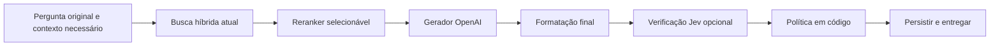

# Plano de implementação do Jev no Digi

Data: 30/09/2026. Plano original, agora com cliente, contratos, modos, testes e runner implementados. Integração desativada por padrão; piloto real, calibração e rollout permanecem pendentes. Consulte [JEV_OPERACAO.md](JEV_OPERACAO.md) para a configuração efetiva e as limitações da primeira versão.

## Objetivo e pré-requisitos

Medir e reduzir afirmações sem suporte documental, preservando respostas úteis, prioridade da curadoria e isolamento do histórico. Usar o Jev para avaliação de evidências e verificação da resposta; manter a geração textual no modelo generativo.

Antes da implementação, resolver os achados P1 pendentes da [revisão de código](CODE_REVIEW_20260930.md), especialmente promoção de texto a curadoria, validação do sucesso da ingestão e configuração de produção. Resolver também a interrupção global das abas para que o dashboard possa validar o experimento. Atualizar as dependências vulneráveis e repetir a auditoria.

Aplicar [guardrails](GUARDRAILS.md), [TDD](TDD.md) e [SDD](SDD.md), com rastreabilidade pela [spec 002](../specs/002-integracao-jev.md). A proteção contra publicação vazia foi implementada nesta preparação, conforme [spec 001](../specs/001-publicacao-documentos.md); permanecem pendências de publicação parcial/concorrente.

Providenciar acesso à API e configurar a chave pelo ambiente, nunca pelo código. A chave do novo fornecedor deve receber a mesma proteção dos segredos já usados pelo projeto. Confirmar as condições de retenção da conta antes de enviar conteúdo interno. Validar qualidade em português com os casos do Digi.

Referências: [avaliação técnica](VALIDACAO_TYPESAFE_RAG.md), [validação do volume e custos](VALIDACAO_RELATORIO_JEV_20260930.md), [API oficial](https://docs.typesafe.ai/api), [modelos](https://docs.typesafe.ai/models).

## Arquitetura e responsabilidades

| Componente | Responsabilidade |
| --- | --- |
| `src/services/typesafe_service.py` | Cliente HTTP assíncrono, payloads, respostas tipadas, validação, retries limitados e métricas de uso |
| `src/models/` | Decisões de evidência, resultado de verificação e uso; separados de `Document.score` |
| `src/agents/rag_agent.py` | Receber reranker injetado e preparar pergunta/candidatos; sem construir cliente de rede |
| `src/pipeline/rag_pipeline.py` | Executar verificação da resposta final e decidir entrega, abstenção ou encaminhamento |
| `src/api/dependencies.py` | Criar serviço uma vez no application state e fechar cliente próprio no lifespan |
| `src/config.py` | Validar chave, modos, versão, limites e prazos |
| `db/migrations/` | Persistência ordenada das métricas, se aprovada para a implantação; RLS e revogação de acesso público |
| `dashboard/` e `evals/` | Acompanhar resultados, executar comparações e exibir custo observado |

Implementar inicialmente com `httpx.AsyncClient`, já utilizado pelo projeto, e Pydantic para validar respostas. O SDK é alternativa, mas não é necessário para o endpoint `POST https://api.typesafe.ai/v1/systemone`. O serviço recebe cliente injetável; só encerra os recursos que possui. Não montar cliente no agente.

## Configuração proposta

Os nomes e valores abaixo foram implementados na primeira versão. Os limites iniciais ainda precisam ser confirmados pelo piloto. O guia operacional acrescenta orçamento volátil, limite conservador de bytes e configuração de critérios, presentes em `.env.example`.

| Variável | Padrão proposto | Regra |
| --- | --- | --- |
| `TYPESAFE_API_KEY` | ausente | `SecretStr`; obrigatória quando alguma chamada Jev estiver ativa |
| `TYPESAFE_MODEL` | `jev-1.13.0` | Versão fixa; registrar também a versão efetiva da resposta |
| `RERANK_PROVIDER` | `openai` | `openai` ou `typesafe` |
| `TYPESAFE_RERANK_SHADOW` | `false` | Avaliar ordenação alternativa sem alterar os documentos usados |
| `TYPESAFE_VERIFY_MODE` | `off` | `off`, `shadow` ou `enforce` |
| `TYPESAFE_HTTP_TIMEOUT_SECONDS` | `3` | Timeout por tentativa, limitado e configurável |
| `TYPESAFE_STAGE_DEADLINE_SECONDS` | `10` | Deadline total por etapa, incluindo fila e retries |
| `TYPESAFE_MAX_RETRIES` | `1` | Retry só para erro transitório; não repetir erro de autenticação ou payload |
| `TYPESAFE_MAX_CONCURRENCY` | `4` | Limite compartilhado por processo, não um limite novo por consulta |
| `TYPESAFE_MAX_CANDIDATES` | `15` | Teto inicial compatível com o pool padrão atual |
| `TYPESAFE_MAX_CHUNK_CHARS` | `6000` | Limite explícito; registrar truncamento e incluir metadados relevantes |

Contabilizar tokens de perguntas, critérios, histórico e texto, não apenas caracteres. Aplicar orçamento total de entrada dentro dos limites documentados do modelo e reservar espaço para a resposta gerada na verificação. Se a carga exceder o limite, dividir ou reduzir contexto com rastreabilidade; não truncar silenciosamente a evidência e considerar a verificação completa.

Definir limiares em um artefato versionado de critérios após calibração, por modo e por versão. Não copiar os limiares do exemplo do fornecedor nem reutilizar `SCORE_THRESHOLD`. `Noul` fornece probabilidade; `Choice`/`Score` fornecem distribuições e confiança. Nenhum desses campos equivale a garantia de verdade. [Confiança oficial](https://docs.typesafe.ai/confidence).

## Contratos de avaliação

### Reranking

Entrada: pergunta original, reescrita como contexto auxiliar, mínimo de histórico para resolver referências e candidatos reais com ID, texto e metadados confiáveis. Excluir correções aposentadas antes da avaliação.

Avaliar cada par pergunta–chunk com perguntas atômicas sobre relevância, evidência utilizável e conflito com premissas da pergunta. Detecção de instruções no conteúdo é sinal complementar; não substitui a separação de dados e instruções. Agrupar perguntas do mesmo par em uma chamada e manter candidatos concorrentes sob o limite global.

Saída interna: IDs dos candidatos e probabilidades/decisões validadas, além de uso, duração e modelo. Mapear sempre de volta aos objetos originais, sem conteúdo ou IDs inventados. Ordenação e desempate ficam no código; preservar a autoridade de curadoria vigente. Um documento que corrige uma premissa falsa deve poder ser selecionado.

Se falhar, retornar ao reranker atual ou à ordem de recuperação conforme política explicitamente testada, registrando o fallback. O score de busca não deve ser sobrescrito por probabilidade Jev. Em observação, a alternativa Jev não altera a resposta entregue.

### Verificação da resposta

Entrada: resposta final após formatação, pergunta e documentos efetivamente usados. Avaliar afirmações concretas — passos, telas, limites, prazos, endpoints — contra as fontes. Não considerar a pergunta ou o histórico evidência factual autoritativa.

Na primeira versão, manter a resposta textual atual e avaliar dimensões atômicas de suporte, contradição e respeito à curadoria. No piloto, anotar manualmente afirmações críticas para avaliar a capacidade do verificador de detectá-las. Qualquer extração automática de afirmações também precisa de avaliação de cobertura: uma afirmação omitida na extração não pode desaparecer da verificação.

Uma evolução pode introduzir geração interna estruturada com afirmações, IDs de fonte e citações literais. Nesse caso, código valida ID e presença da citação, Jev valida suporte semântico e o renderizador monta a resposta final a partir do conteúdo verificado. Mudanças substantivas depois da verificação exigem nova checagem. [Receita oficial de verificação](https://docs.typesafe.ai/cookbooks/citation_check).

Saída: `supported`, `unsupported`, `contradicted` ou `uncertain` por decisão, mais status de transporte independente. Timeout/erro nunca vira `supported`. A regra agregadora considera todos os itens avaliados e não mascara uma contradição com a média das outras decisões.

| Modo | Comportamento |
| --- | --- |
| `off` | Não chama Jev; caminho atual |
| `shadow` | Registra decisões; entrega a resposta atual mesmo se houver falha da avaliação |
| `enforce` | Entrega somente se passar nos critérios calibrados; falha/ausência de suporte resulta em encaminhamento ou abstenção |

Se regeneração for adotada, limitar a uma tentativa e verificar a resposta regenerada. Em `resposta-cliente`, usar a mensagem institucional de encaminhamento; nos demais modos, explicar a ausência de informação suficiente. Persistir a resposta efetivamente entregue, não uma resposta rejeitada como se fosse a saída final.

## Segurança, falhas e observabilidade

Usar o endpoint HTTPS fixo e autenticação no servidor. Conservar `require_api_key` em todas as rotas privadas. Perguntas, chunks, histórico e resposta são dados não confiáveis; instruções e critérios pertencem ao sistema.

Não registrar chave, headers de autenticação, texto da conversa, chunks ou corpo externo em logs. Para o usuário, erros são genéricos; no servidor, registrar tipo/status e correlação, sem segredos. O verificador não habilita chamadas de ferramentas nem executa ações descritas nos documentos.

Retry limitado para 429/502/503/504 e erros transitórios de transporte, sempre respeitando o deadline; limitar a espera solicitada em `Retry-After` ao tempo restante. Cancelamento interrompe as tarefas em andamento. Uma fila local por processo não garante o limite de conta quando há vários workers; dimensionar o conjunto ou adotar limitador compartilhado.

Registrar por etapa: modo, modelo, versão dos critérios, chamadas, tokens de entrada/saída, custo estimado, duração, decisões, falhas, truncamento e fallback. Persistência usa IDs pseudonimizados/correlação, sem duplicar conteúdo sensível. A migração deve incluir RLS, privilégios backend, índices necessários e retenção definida.

O orçamento inicial de planejamento é US$ 1 por 30 dias para consumo Jev no volume atual. Isso não representa mínimo de recarga. Monitorar consumo e estabelecer política para saldo/orçamento esgotado: em observação, pular avaliação e registrar; em verificação obrigatória, encaminhar em vez de entregar resposta não verificada. Um limite local por processo não é teto financeiro global.

## Experimento e custos

Comparar A: pipeline atual; B: reranker OpenAI com pergunta original e texto mais completo; C: Jev com a mesma entrada de B; D: C com verificação. Congelar candidatos/corpus para isolar diferenças e separar calibração de avaliação. Ampliar os 32 casos para cobrir bugs, resposta-cliente, follow-ups, ausência de fonte, versões conflitantes e conteúdo adversarial.

O volume confirmado foi 702 consultas em 90 dias, média de 234 por 30 dias. Com 22.500 tokens por reranking e 10.000 por verificação, ao preço publicado de US$ 0,042/Mtoken de entrada, estimam-se US$ 0,22/mês para reranking, US$ 0,10 para verificação e US$ 0,32 para ambos. São hipóteses de consumo, não faturamento medido. OpenAI, Supabase, retries, impostos e câmbio ficam fora desses valores. [Preço oficial](https://docs.typesafe.ai/models).

As variantes C e D, executadas separadamente em 32 casos cinco vezes, custariam cerca de US$ 0,37 somadas em Jev, com essas hipóteses. Gerador e juiz têm cobrança adicional. Substituir estimativas por `usage.input_tokens` do piloto.

## Entregas e aceite

1. Corrigir pré-requisitos da revisão e produzir baseline independente, com revisão humana das divergências.
2. Implementar serviço, contratos, configurações e testes de sucesso, entrada inválida, chave ausente e falha externa.
3. Validar timeout, cancelamento, concorrência, retries, resposta malformada, IDs inesperados, orçamento e isolamento de metadados.
4. Habilitar verificação em observação; acompanhar sensibilidade aos erros e falsos bloqueios propostos.
5. Executar comparação A/B/C/D; medir fidelidade, correção, completude, respostas úteis entregues, abstenções, estabilidade, p50/p95 e custo.
6. Definir critérios numéricos antes de ativar enforcement, com conjunto reservado e análise da incerteza. Não considerar uma taxa maior de recusa prova de melhoria.
7. Ativar gradualmente apenas se houver ganho demonstrado, mantendo rollback por configuração; rodar todas as verificações de `AGENTS.md` antes da entrega.

Condição de conclusão: integração desativada preserva o caminho atual; integração ativa é testável sem rede; rollout tem métricas e rollback; nenhuma resposta é aprovada por falha do verificador; ganho em português é sustentado pelo conjunto reservado. A documentação descreve a configuração efetivamente implementada e o dashboard distingue volume temporal de totais acumulados.
