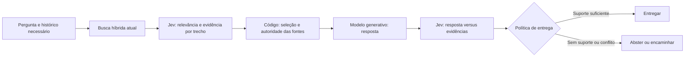

# Validação do TypeSafe AI para o RAG do Digi

Data: 30/09/2026. Escopo: documentação oficial do fornecedor e inspeção do código local. Este relatório avalia viabilidade e define o experimento; não contém resultados de chamadas ao Jev. Não foi encontrada credencial TypeSafe na `.env`, e `evals/reports/` não está disponível neste checkout.

## Parecer

O Jev é candidato para substituir o reranker e classificar a utilidade dos trechos recuperados. Para o objetivo de reduzir afirmações sem suporte, o encaixe adicional mais direto é verificar a resposta contra as evidências antes de entregá-la. A recomendação é testar essas duas intervenções separadamente, começando em avaliação offline e modo de observação.

Não há evidência suficiente para afirmar que ele é a melhor IA para ler documentos, nem para prever uma queda drástica de alucinação no Digi. A API faz decisões tipadas; a geração textual continua com um modelo generativo. [Introdução oficial](https://docs.typesafe.ai/introduction).

## O que a documentação sustenta

O fornecedor oferece um exemplo de reranking: 40 consultas jurídicas em inglês, com shortlist BM25 de 30 passagens. O top-1 sobe de 5% para 18%, e o top-10 de 38% para 62%. É uma demonstração contra BM25 sem reranker, não contra o reranker OpenAI do Digi. O reranker só reordena candidatos já recuperados. [Cookbook de reranking](https://docs.typesafe.ai/cookbooks/rerank_typesafe).

A expressão comercial “zero alucinações” exige cuidado. No artigo de lançamento, o próprio fornecedor explica que o zero decorre da garantia de correspondência ao schema, e não de uma medição de veracidade factual. Uma decisão com formato válido pode estar semanticamente errada. [Artigo de lançamento, seção Hallucination and Type-safety](https://typesafe.ai/blog/introducing-system-one-models-and-jev).

A documentação atual lista `jev-1.13.0`, entrada exclusivamente textual e preço de US$ 0,042 por milhão de tokens de entrada, sem cobrança por tokens de saída. Os limites publicados são 40 requisições/s e 100 mil tokens/s, sujeitos a mudança; o contexto permite 64 mil tokens totais e 32 mil para o estado mais a maior pergunta. Inglês é o idioma com melhor desempenho; português precisa de avaliação própria. Para testes reproduzíveis, fixar a versão. [Modelos](https://docs.typesafe.ai/models).

O fornecedor reconhece falhas com leitura literal, raciocínio indireto, números, excesso de contexto irrelevante e conteúdo adversarial. Isso favorece decisões pequenas por trecho e desaconselha enviar o manual inteiro indiscriminadamente. [Limitações do Jev 1.13](https://docs.typesafe.ai/model-jaggedness/jev-1.13).

## Evidências no código atual

- `src/agents/rag_agent.py`: recupera normalmente até 15 candidatos para manter 10. Quando há reescrita, funde buscas da pergunta original e da reescrita, mas chama o reranker somente com `search_query`. Se a reescrita perder a intenção, esse efeito ainda pode afetar a ordenação.
- `src/services/openai_service.py`, método `rerank`: cada candidato é reduzido aos primeiros **300 caracteres**. Informação importante depois desse ponto não participa do julgamento. Também não envia a autoridade de curadoria dos metadados. Quando há até `top_n` candidatos, pula a avaliação e devolve todos eles.
- `src/services/openai_service.py`, método `generate_response`: prioriza respostas curadas e pede que o modelo não invente dados, mas permite complementar contexto parcial com conhecimento geral. Não existe verificação semântica da resposta pronta antes da entrega. Isso é uma possível fonte de afirmações sem suporte, não uma causa medida neste estudo.
- `src/services/curadoria.py`: a autoridade vem de metadados, e correções substituídas são excluídas na busca. A integração deve preservar essas regras; relevância prevista por um modelo não redefine autoridade documental.
- `src/agents/rag_agent.py`: o `score` retornado é a média dos scores de busca dos documentos selecionados. Ele não representa probabilidade de a resposta estar correta. Métricas do Jev precisam de campos separados.

O dataset local tem 32 casos: 31 de orientação, um de resposta ao cliente e nenhum de bug; 11 incluem erros proibidos. É útil para regressão inicial, mas insuficiente para representar todos os usos e calibrar limites com segurança.

## Desenho recomendado

### 1. Substituir reranking por avaliação de evidências

Para cada candidato, fornecer a pergunta original, a reescrita como contexto auxiliar, o texto do chunk com limite explícito e os metadados necessários. Em follow-ups, incluir apenas o contexto necessário para resolver referências, sem tratar o histórico como fonte factual autoritativa.

Perguntas separadas podem avaliar: relevância para a intenção, presença de informação utilizável na resposta, contradição de uma premissa da pergunta e tentativa de instruir o modelo. Contradizer uma premissa falsa pode tornar um trecho especialmente útil; não é motivo automático para descartá-lo. A política de inclusão e a autoridade das fontes ficam no código. [Classificação de passagens RAG](https://docs.typesafe.ai/cookbooks/classifying_rag_passages).

Começar com uma requisição por candidato e perguntas agrupadas, mantendo concorrência global limitada. Um `Noul` pode ordenar por probabilidade de conter evidência; `Score` permite níveis descritivos, por exemplo irrelevante, apenas relacionado, apoio parcial e apoio direto. Calibrar esse critério com exemplos do Digi. [Score](https://docs.typesafe.ai/primitives/score).

`Noul` não possui campo separado de confiança. `Choice` e `Score` retornam confiança calculada a partir da distribuição de probabilidades. Não interpretar confiança como garantia de verdade nem reutilizar o threshold do Supabase para esses valores. [Confiança](https://docs.typesafe.ai/confidence).

### 2. Verificar a resposta antes da entrega

Avaliar afirmações concretas contra os chunks utilizados: passos, telas, prazos, limites e endpoints. Uma opção de evolução é gerar internamente afirmações com IDs das fontes e citações literais, validar IDs e existência das citações em código e usar o Jev para verificar suporte semântico. A verificação deve cobrir também afirmações sem citação; conferir só as citações declaradas deixa lacunas.

Há exemplo oficial que separa citações verificadas, sem suporte, contraditas e fabricadas. Sua amostra é pequena e demonstrativa; não estabelece a sensibilidade do verificador no Digi. [Verificação de citações](https://docs.typesafe.ai/cookbooks/citation_check).

Em observação, registrar decisões sem bloquear respostas. Depois de calibrar, definir abstenção ou encaminhamento para ausência de evidência, conflito não resolvido ou verificador indisponível. Se houver regeneração, limitar a uma tentativa e verificar novamente. Reduzir respostas erradas apenas recusando tudo não conta como melhora.

### 3. Outros encaixes

Classificação de intenção e validação de escopo combinam com decisões fechadas e podem ser experimentos posteriores de custo e latência. OCR/PDF, embeddings, banco vetorial, reescrita livre e geração textual continuam exigindo componentes adequados a essas tarefas. A entrada textual do Jev pressupõe extração do documento antes da avaliação.

## Experimento para decidir pela adoção

Comparar quatro variantes mantendo corpus, candidatos, gerador e rubricas constantes:

| Variante | Mudança | O que permite medir |
| --- | --- | --- |
| A | Pipeline atual | Referência |
| B | Mesmo reranker OpenAI, pergunta original e texto com limite maior | Ganho por corrigir a entrada |
| C | Jev recebendo a mesma entrada de B | Ganho atribuível ao fornecedor |
| D | C mais verificação antes da entrega | Efeito adicional sobre afirmações sem suporte |

Congelar candidatos por pergunta no primeiro experimento, anotar quais chunks contêm a resposta e incluir casos com a evidência fora da shortlist. Separar fidelidade à fonte, correção factual, completude e respeito à curadoria: uma base errada pode produzir uma resposta fiel, porém errada.

Usar os 32 casos como ponto de partida e acrescentar bugs, resposta-cliente, follow-ups, ausência de documentação, versões conflitantes, detalhes após o caractere 300 e tentativas de prompt injection. Separar calibração e avaliação, repetir gerações e revisar divergências com analista humano; o juiz automático atual não deve ser a única referência.

Medir presença dos chunks corretos em top-1/top-5/top-10, afirmações sem suporte nas respostas entregues, respostas corretas entregues por total de consultas, completude, abstenções, bloqueios indevidos, estabilidade, latência p50/p95, custo e falhas externas. Relatar denominadores e incerteza; não deduzir redução de alucinação apenas de uma melhora na ordenação.

Adotar apenas se houver benefício no conjunto reservado sem perda inaceitável de respostas úteis. Uma redução grande no dataset inicial precisa ser confirmada em uma amostra maior de perguntas reais.

## Integração e operação

Uma futura implementação cabe em `src/services/typesafe_service.py`, com cliente assíncrono injetável, reutilização via application state e fechamento no lifespan. O SDK oferece `AsyncTypeSafeClient`; também é possível usar o endpoint HTTP com o cliente já adotado no projeto. Configurar versão, timeout, retries, tamanho do texto e concorrência, com erros genéricos para o usuário. O SDK informa que corpos de requisições/respostas não são redigidos nos logs: evitar logging de conteúdo sensível. [SDK assíncrono](https://docs.typesafe.ai/sdk/python/api/clients/async), [API HTTP](https://docs.typesafe.ai/api).

Manter autenticação, isolamento de histórico e regras de curadoria. O novo fornecedor receberia perguntas e trechos internos: enviar somente o necessário. O fornecedor declara que não treina modelos com os inputs; isso não equivale a retenção zero em todo plano. As condições da conta devem ser conferidas antes de usar histórico real. [Política de privacidade](https://typesafe.ai/legal/privacy-policy), [documentos e ZDR enterprise](https://docs.typesafe.ai/legal).

Como estimativa ilustrativa, 15 pares de 1.500 tokens cada custariam US$ 0,000945 por consulta ao preço publicado, antes da verificação adicional, retries e das chamadas ao gerador. Não é custo medido do Digi. Quinze requisições por consulta também consomem rapidamente o limite global de requisições; batching e limites da aplicação precisam ser testados.

**Status da análise inicial:** candidato tecnicamente viável para experimento. Redução de alucinação, qualidade em português, custo real e latência no Digi permanecem sem validação empírica. A implementação posterior está registrada em [JEV_OPERACAO.md](JEV_OPERACAO.md), com modos desativados por padrão; as observações sobre código neste estudo descrevem a versão anterior à integração.
